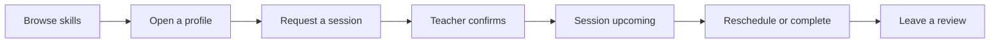
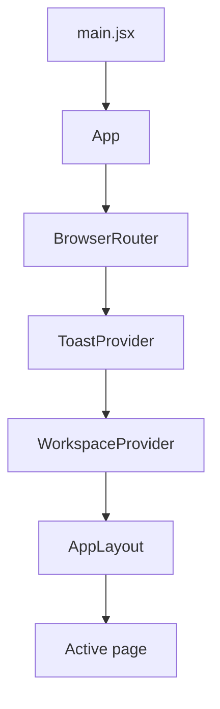

<div align="center">
🔁 TradeCraft
Trade what you know. Learn what you don't.
A campus peer-to-peer skill exchange. No fees, no tutors, just students teaching students.


</div>
---
💡 The idea
You play guitar and want to learn Python. Someone down the hall codes in Python and wants to play guitar. Today that match happens by luck, if it happens at all.
TradeCraft makes it happen on purpose. Find the right student on your campus, book a session, swap skills and leave a review.
> A team project for **Front End Engineering-II (React)** and **Database Management Systems (raw SQL / MySQL)**. This repo holds the React front end.
🧭 How it feels to use

✨ Features
	What you get
🔎 Discover	Categories, skill search and teacher profiles with ratings
👥 Student directory	Debounced search, campus and department filters, sorting, pagination
📅 Bookings	Request, confirm (demo), reschedule, complete or cancel, with past-date and duplicate-slot checks
⭐ Reviews	One review per completed session
🧰 My Skills	Add and remove what you teach and want to learn
🔐 Accounts	Demo register and login, protected pages that return you to where you were headed
🌐 Community	Live repositories from the GitHub API, with offline fallback data
🧼 Polish	Loading, error and retry states, toasts, keyboard-friendly dialogs, responsive layout
🚀 Try it in 60 seconds
Requires Node.js 18+. The app lives in the `tradecraft/` folder.
```sh
git clone https://github.com/rishabh01-hyp/Trade-Craft.git
cd Trade-Craft/tradecraft
npm install
npm run dev
```
Open the URL Vite prints (usually `http://localhost:5173`). Sample accounts are in `src/data/loginCredentials.js`, or register a demo profile with any ten-digit roll number.
Quick tour: log in → open Students → pick a teacher → Request session → go to Bookings → confirm it → complete it → write a Review.
<details>
<summary><b>🛠 All scripts</b></summary>
Command	What it does
`npm run dev`	Dev server with hot reload
`npm run build`	Production build in `dist/`
`npm run preview`	Serve the production build locally
`npm run lint`	Run ESLint
`npm test`	Run the workflow tests
</details>
🧱 Under the hood

Global state (Context): bookings and skills per user in `WorkspaceProvider`, notifications in `ToastProvider`.
Local state: form fields, modals and tabs stay inside the page that owns them.
Custom hooks: `useFetchData` (loading, error, retry), `useLocalStorage`, `useDebouncedValue`.
Reusable forms: controlled inputs in `components/ui`, validated on blur, while typing and on submit.
Rules live in services: booking validation and slot conflicts sit in `services/bookings.js`, away from the UI.
<details>
<summary><b>📁 Project structure</b></summary>
```
tradecraft/
├── src/
│   ├── Pages/        Route-level screens (Home, Students, Bookings, ...)
│   ├── components/   Modal, Pagination, Toasts, ui/ form fields
│   ├── layouts/      AppLayout: sidebar, top bar, page area
│   ├── hooks/        useFetchData, useLocalStorage, useDebouncedValue
│   ├── services/     api.js, bookings.js, storage.js
│   ├── data/         Mock data and demo credentials
│   └── styles/       global.css, ReviewsPage.css
└── tests/            Workflow tests
```
</details>
<details>
<summary><b>🗺 Routes</b></summary>
Path	Page	Access
`/`	Home	Public
`/search`	Search	Public
`/students`	Student directory	Public
`/categories`, `/categories/:categoryId`	Categories	Public
`/skill/:skillName`	Skill page	Public
`/student/:studentId`	Student profile	Public
`/community`	GitHub community feed	Public
`/login`, `/register`	Authentication	Public
`/book/:studentId`	Request a session	🔒 Login
`/bookings`	Manage bookings	🔒 Login
`/my-skills`	Manage skills	🔒 Login
`/reviews`	Reviews	🔒 Login
`*`	404 page	Public
</details>
🛣 Roadmap
[x] Multi-page SPA with dynamic and protected routes
[x] Context-based workspace for bookings and skills
[x] Validated, reusable form components
[x] Async loading, error and retry handling
[ ] Node/Express backend with a MySQL database (raw SQL, no ORM)
[ ] Skill Credits: earn credits by teaching, spend them to learn
[ ] Google Meet link on every online session
⚠️ Demo boundaries
TradeCraft runs entirely in the browser for now.
Data lives in `localStorage`, so it is local and editable. Login and route guards are teaching examples, not real authentication.
Teacher confirmation and completion are simulated. Nothing is sent to another person.
Sample students and ratings are fixtures. Registering does not add anyone to the public directory.
Slot checks compare start times only, not session length.
Hosting must serve `index.html` for every route (for example `/students`).
📚 Go deeper
`FLOW_OF_CONTROL.md`: startup, every route, state ownership
`DECISIONS.md`: design decisions and trade-offs
`PROJECT_TOPICS.md`: syllabus topics mapped to files
<!--
Add screenshots here once you have them, for example:
## 📸 Screenshots

<div align="center">
Made with ☕ and React by the TradeCraft team.
</div>
