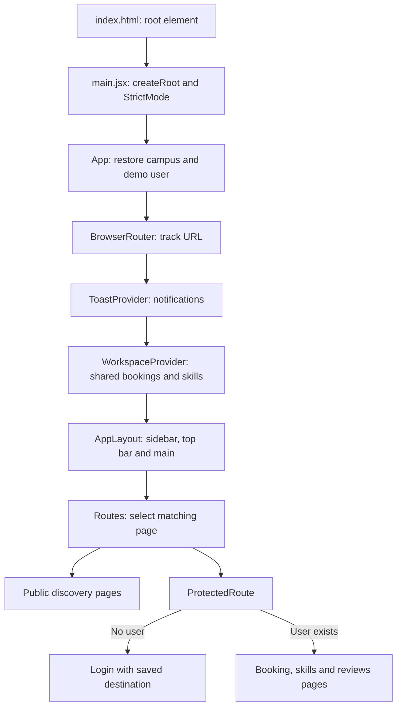
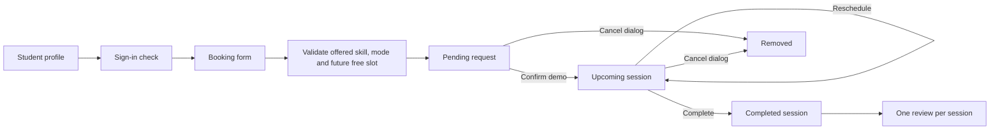

# TradeCraft: control flow and viva guide

## 1. What to say first in the viva

"TradeCraft is a campus skill-exchange SPA. Students browse sample teachers, create a demo profile, request sessions, manage bookings and leave feedback. React renders the interface, React Router selects pages, Context shares workspace state, and localStorage retains browser data. The Community page demonstrates a real asynchronous fetch request. There is no application backend."

The implementation follows the supplied PE-I topics: HTML, CSS, JavaScript, DOM interaction, React, basic routing, SPA layouts, local/global state, Context, asynchronous state, and validated reusable forms. Redux Toolkit and Zustand are comparison topics; neither is installed.

## 2. Start-up sequence

1. The browser loads `index.html`, which imports `src/main.jsx`.
2. `main.jsx` imports global CSS and mounts `App` inside `StrictMode`.
3. `App` restores the selected campus and demo user using `useLocalStorage`.
4. The router exposes URL information to the components inside it.
5. Providers supply notifications and workspace data to descendants.
6. `AppLayout` renders shared navigation and the matching page through `children`. Login and registration use a full-screen form layout. This app does **not** use `Outlet`.
7. Event handlers update React state. React renders the resulting UI. Persistence runs after the state update commits.

**Crucial decision:** there is one HTML entry file, but many URL-based page components. A multi-page-looking SPA is different from a server returning a new HTML document for every link.

## 3. Route map

| URL | Page | Control flow |
| --- | --- | --- |
| `/` | Home | Load sample home data; show daily skill and discovery links. |
| `/search?q=React` | Search | Read query string; find skills and teachers for the selected campus. |
| `/students` | Students | Debounce input; filter, sort and paginate sample students. |
| `/categories` | Categories | Load and render category cards. |
| `/categories/:categoryId` | CategoryDetail | Read parameter; display category skills or not-found message. |
| `/skill/:skillName` | SkillPage | Read decoded router parameter; load skill and campus teachers. |
| `/student/:studentId` | StudentProfile | Load teacher; display skills, ratings and request link. |
| `/community` | Community | Fetch popular GitHub repositories; show loading, retry or bundled fallback. |
| `/login` | Login | Match sample credentials or continue the most recently saved demo profile. |
| `/register` | Register | Validate profile, save it, sign in and return to the requested page. |
| `/book/:studentId` | BookingRequest | Protected: validate and create a pending request. |
| `/bookings` | Bookings | Protected: confirm, reschedule, complete or cancel. |
| `/my-skills` | MySkills | Protected: add/remove teaching and learning skills. |
| `/reviews` | ReviewsPage | Protected: review completed bookings once; display sample received ratings. |
| Anything else | NotFound | Show a recovery link. |

`Link` navigates without a full reload. `NavLink` also supplies active-link styling. `useNavigate` redirects after form submission. `useParams` reads path parameters; `useSearchParams` reads the search query. `useLocation` reads the current URL and saved navigation state.

## 4. State ownership: a likely viva question

| State | Owner | Reason |
| --- | --- | --- |
| Campus and demo user | App, passed through props | Needed by layout, route guards and discovery pages. |
| Bookings and skills | WorkspaceProvider via Context | Several distant pages read or modify the same workspace. |
| Toasts and dismissal timers | ToastProvider | Any page can notify the user. |
| Inputs, selected tab, modal target | Individual page via useState | Only that page needs this transient state. |
| Search URL | Router | Query can be bookmarked and revisited. |
| Loading/error/result | useFetchData | Reusable asynchronous lifecycle. |
| Given reviews | ReviewsPage with useLocalStorage | Used on one page; does not need another global store. |

**Crucial decision:** Context transports React state; localStorage persists it. They do different jobs. Components should not treat localStorage as a reactive database. `WorkspaceProvider` is keyed by roll number so switching demo users remounts the provider and reloads the correct workspace.

## 5. Booking flow, step by step

1. `StudentProfile` links to `/book/<id>`.
2. `ProtectedRoute` redirects a guest to Login and stores the destination.
3. Login restores that destination after successful demo sign-in.
4. `BookingRequest` loads the teacher. The form stores skill, mode, date and time locally.
5. Submission calls `preventDefault`, verifies the teacher's options, rejects past times and checks pending/upcoming bookings for an identical slot.
6. A new record gets a UUID and `pending` status. An immutable update prepends it to Context's pending array.
7. `useLocalStorage` persists the committed state. `Bookings` reads the same Context immediately, so there is no second stale API copy.
8. Confirm (demo) moves the record to `upcoming` and sets `confirmed`; Complete moves it to `completed`. `moveBooking` removes the old record before adding it to its destination.
9. Reschedule validates before using `map` to replace the matching record. Cancellation uses `filter` after modal confirmation.
10. Reviews derives its choices from completed bookings and excludes previously reviewed IDs. Submission updates `reviewsGiven`, not the user's received ratings.

**Crucial decisions:** confirmation is explicitly simulated; completion can also be demonstrated immediately. No real teacher receives a message. Slots use the browser's local date/time and detect exact start-time conflicts; duration overlap and teacher availability are future backend work.

## 6. Registration and forms

`Register` keeps `values`, `errors` and `touched` in local state. Each input receives its current value and a change handler. Blur marks a field touched and validates it; later typing revalidates that field. Submit validates every field before saving.

Validation covers names, a ten-digit roll number, email format, campus and department membership, optional bio length, and a nonempty list of up to five distinct teaching skills. Sample-account roll numbers must use the sample login.

`TextField`, `SelectField` and `TextAreaField` wrap native inputs in `Field`. `Field` supplies a label and either an error or hint. Inputs connect to the message using `aria-describedby` and expose invalid state with `aria-invalid`.

**Crucial decision:** registration creates a browser-only demo profile without collecting a password. It signs the user in and seeds My Skills. Login can continue the latest saved profile. Existing sample password matching remains an example of a controlled login form, not secure authentication. Only the most recently registered profile has a quick-continue button.

## 7. Async flow and error handling

1. A page calls `useFetchData(loader, dependencies)`.
2. The hook builds a request key from dependency values and the retry attempt.
3. `useEffect` runs the loader. Until the result key matches, the page shows Loading.
4. Success stores data; rejection stores an error. Pages show ErrorState with Retry.
5. Cleanup marks an old request cancelled so an obsolete result cannot overwrite the latest one.
6. Retry increments the attempt, immediately making the current result stale and restoring loading UI.

The mock loaders and student directory resolve Promises after a short delay. They do not make HTTP calls. Community uses `fetch`, checks `response.ok`, parses JSON and maps GitHub results to card data. Its offline list is bundled sample data, not a cache of live results.

**Crucial decision:** dependencies passed to `useFetchData` must include every value read by its loader. They must be simple JSON-serializable values. Cancellation ignores stale results; it does not abort the underlying HTTP request.

## 8. DOM, CSS and accessibility

React owns content updates. Avoid `innerHTML` or manually appending React-managed elements. DOM access is reserved for browser interactions:

- `main.jsx`: find the root element and mount React.
- `Modal`: focus the dialog, keep Tab navigation inside it, close on Escape, restore focus and body scrolling after close.
- `CampusSelector`: use a ref and a document mouse listener to detect outside clicks; remove the listener during cleanup.
- Toasts/debounce: timers are cleaned up to prevent orphaned callbacks.

`global.css` provides variables, resets, shared controls, navigation, responsive Grid/Flexbox layouts and page styles. `ReviewsPage.css` adds review-specific cards and rating distribution bars. Semantic elements, input labels, button types, focus and ARIA attributes support keyboard and assistive-technology use.

## 9. Whole-project file summary

All paths below are relative to the project directory.

| File or directory | Responsibility |
| --- | --- |
| `index.html`, `public/favicon.ico` | HTML shell, root element and browser icon. |
| `package.json`, `package-lock.json` | Scripts, dependencies and locked dependency versions. |
| `vite.config.js` | Register React support for development and builds. |
| `eslint.config.js` | JavaScript, hooks and Fast Refresh lint rules. |
| `.gitignore` | Exclude dependencies, build output and local editor files. |
| `src/main.jsx` | Mount App and import shared CSS. |
| `src/App.jsx` | Providers, persistent campus/user state, route table and guards. |
| `src/layouts/AppLayout.jsx` | Sidebar links, mobile menu, campus selector, top bar and page container. |
| `src/Pages/*.jsx` | One component per route; responsibilities are listed in section 3. |
| `src/components/WorkspaceProvider.jsx` | Shared persisted bookings and skills, plus storage failure notice. |
| `src/components/workspaceContext.js` | Context object and useWorkspace consumer hook. |
| `src/components/Toasts.jsx`, `toastContext.js` | Notification provider, timed dismissal, rendering and consumer hook. |
| `src/components/Modal.jsx` | Reusable keyboard-accessible dialog with content and footer slots. |
| `src/components/SearchBar.jsx` | Controlled search input; submit navigates to a query-string URL. |
| `src/components/CampusSelector.jsx` | Dropdown reporting campus changes to App. |
| `src/components/StudentCard.jsx` | Reusable linked student summary with skills and ratings. |
| `src/components/RatingDisplay.jsx` | Display teaching and learning scores. |
| `src/components/Pagination.jsx` | Page numbers, gaps and previous/next controls. |
| `src/components/Loading.jsx`, `ErrorState.jsx` | Shared progress and retry UI. |
| `src/components/ui/Field.jsx` | Common label, validation message and hint layout. |
| `src/components/ui/TextField.jsx` | Controlled text/email/password-compatible input. |
| `src/components/ui/SelectField.jsx` | Controlled select accepting strings or value/label objects. |
| `src/components/ui/TextAreaField.jsx` | Controlled multiline input and character count. |
| `src/hooks/useLocalStorage.js` | Initialize state safely; persist after commit; report write failure. |
| `src/hooks/useFetchData.js` | Request lifecycle, stale-result handling and retry. |
| `src/hooks/useDebouncedValue.js` | Delay a changing value until typing pauses. |
| `src/services/storage.js` | JSON read/write and fallback-shape checks. |
| `src/services/bookings.js` | Local date helper, slot validation and immutable status transitions. |
| `src/services/api.js` | Read-only mock directory filtering, sorting and pagination. |
| `src/data/mockData.js` | Campuses, students, categories, skills, offline repos and async lookup functions; includes legacy booking/skill fixtures no longer used to seed personal workspaces. |
| `src/data/mockReviews.js` | Sample received rating data; legacy given/session fixtures are not used for new feedback. |
| `src/data/loginCredentials.js` | Public sample credentials and matching function. |
| `src/styles/global.css`, `ReviewsPage.css` | Shared responsive styling and review styling. |
| `tests/workflows.test.js` | Node tests for transitions, slot validation, storage recovery and directory queries. |
| `README.md` | Setup, demo steps and limitations. |
| `PROJECT_TOPICS.md` | Supplied syllabus mapped to the implementation. |
| `FLOW_OF_CONTROL.md` | This file: execution, file summary and viva walkthrough. |
| `DECISIONS.md` | Reasons, alternatives, tradeoffs and review findings. |

## 10. Short viva answers

- **Why React?** Reusable components render from state, reducing manual DOM synchronization.
- **Props versus state?** Props are parent-supplied inputs; state belongs to the component/provider and changes through setters.
- **Why Context?** Booking and skill pages need the same state without passing it through every intermediate component.
- **Why not put everything in Context?** Form inputs and modal flags are local concerns. Keeping them local makes ownership clear.
- **Why not Redux Toolkit or Zustand?** This small project has two shared workspace collections. Context plus useState is sufficient. Redux Toolkit offers a structured store with slices/actions; Zustand offers a hook-based store. Neither is necessary to demonstrate the current syllabus.
- **Why spread/map/filter?** They create new objects/arrays so React can detect updates without mutating prior state.
- **Why keys?** Stable record IDs help React preserve the correct list item identity. The provider's user key intentionally resets workspace state when the user changes.
- **Why useEffect?** Persistence, listeners and async requests synchronize React with external browser systems after rendering.
- **Why useRef?** It holds a DOM element or timer collection without causing a render when the reference changes.
- **Why preventDefault?** Forms should update the SPA instead of doing the browser's default full-page submission.
- **Is the route guard secure?** No. It demonstrates conditional navigation; real authorization belongs on a server.
- **Is CRUD necessarily REST?** No. This app creates, reads, updates and deletes local records. Only Community performs a real HTTP read.

## 11. Suggested demonstration order

1. Explain `main.jsx → App → providers → layout → route`.
2. Browse categories, a skill and a teacher; explain props and route parameters.
3. Request a session while logged out; demonstrate the login redirect and return.
4. Create a demo profile using a new ten-digit roll number; show invalid fields first.
5. Add/remove a skill and try a duplicate.
6. Request a future session; open Bookings, confirm, reschedule and complete it.
7. Leave feedback; show that the same session disappears from review choices.
8. Refresh to demonstrate persistence; switch sample users to demonstrate separate workspaces.
9. Show directory filters and pagination; explain debounce and array methods.
10. Show Community loading/retry and explain real fetch versus mock Promises.

Keep the browser demo honest: data is local, sample received ratings are fixtures, and teacher confirmation is simulated.
